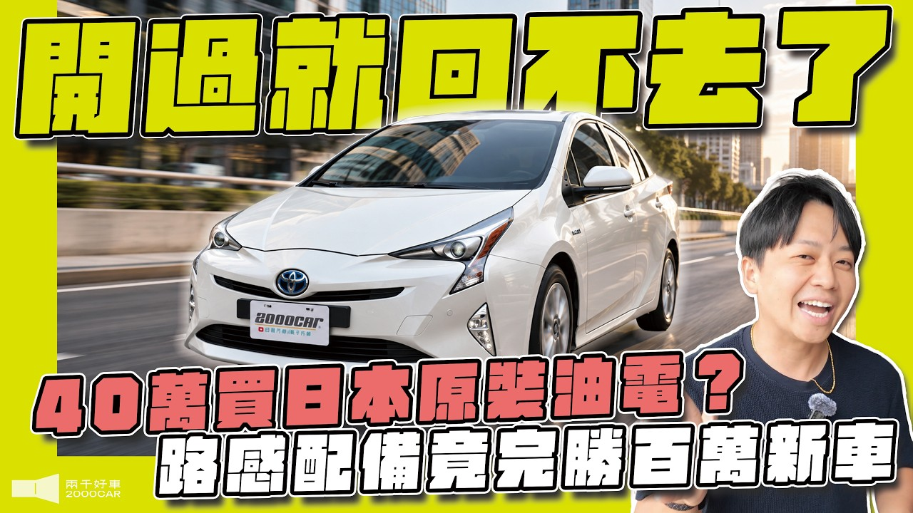
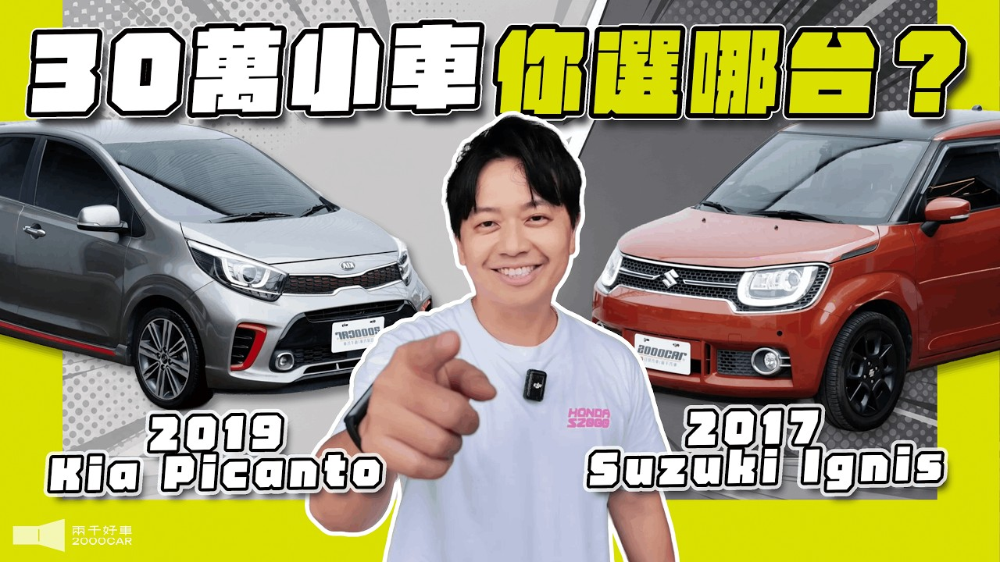
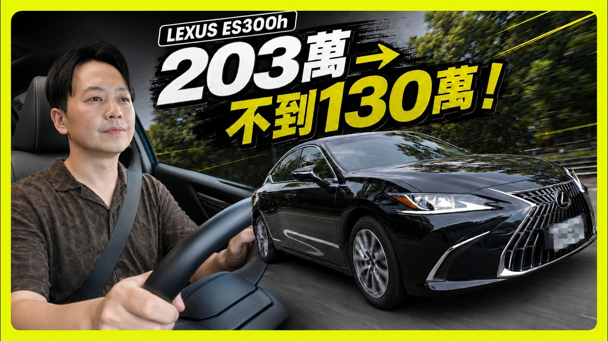

# 兩千 YouTube 封面製作標準

版本：2026-11-06。適用 `/2000yt 封面`，以一般影片為主，不包含 Podcast。

## 依據與適用範圍

已逐張檢視原下載資料夾當前存在的 **22 張**封面，日期為 2026-05-09～2026-10-31，全部為 1280×720。原下載清單為 26 張，另 4 張已不在資料夾內，未納入本次視覺歸納。完整證據見 [觀察索引](cover-observations.md) 與 [來源及雜湊](cover-corpus.json)。

以下把「圖片可見的慣例」與「之後製作的起始規格」分開描述。像素範圍、配色替代值與字數建議是本次整理的可操作規格，不是從原始 PSD 讀出的參數；圖片本身也不能證明所用字型、素材生成方式或點閱成效。

## 一、應保留的品牌識別

| 圖片可見的共同語言 | 製作方式 |
| --- | --- |
| 鮮亮的黃綠／螢光黃框與底色 | 預設用黃底建立外框；常見左右色帶和下方黃底，另一支系用四周圓角黃框。21／22 張有其中一種黃框。 |
| 很粗、偏窄、帶切角或斜勢的字形 | 用支援繁體中文的超粗字重，配黑描邊、細白外緣及暗色陰影。須以參考圖核對字形，不能把任意粗黑體說成原字型。 |
| 上方一個大主標，中間看車與人，下方補一句 | 新作預設先用這個版面；雙車比較、價差和議題型再依其專用結構調整。 |
| 車是主角，人物提供頻道辨識和情緒 | 21／22 張出現主持人或來賓；主車通常是清楚的前側三分之四角度。人物多為白邊去背照，但不是每種版型都用白邊。 |
| 黃、白、黑為骨架，紅色用於第二重點或警示 | 紅色不必每張都有。比較版可只用黃白，價差版偏黃白黑，碰撞議題才增加警示紅黑。 |
| 左下角常有「兩千好車 2000CAR」識別 | 有官方 Logo 就沿用；尺寸低調，不搶主標。不能從縮圖重畫文字後宣稱是官方 Logo 原檔。 |

主版型的實際參考：

## 二、畫布、配色與安全位置

預設畫布 **1280×720、16:9、sRGB**。若使用者指定更高解析度，按比例放大後檢查縮圖，不把低解析人物或車照硬放大當成清晰原圖。

| 項目 | 1280×720 的起始設定 |
| --- | --- |
| 品牌底黃 | `#DAE000`；多張標準版左側純色區的 JPEG 取樣接近／等於此值。黃框價差版可更偏亮黃綠，跟所選參考，不強制全批同色。 |
| 黑／白 | 黑約 `#080808`，白 `#FFFFFF`；皆為重建用起始值。 |
| 副標紅 | 可從接近 `#EF6A70` 的珊瑚紅開始；警示議題可用更飽和紅。紅色值為近似重建，非已確認原始色票。 |
| 黃色側帶 | 主版型左右各約 64～80 px，常見約 80 px；主體可有意跨過色帶。不要在所有特殊版型上硬加同樣側帶。 |
| 主標區 | 約 y=12～180，幾乎橫跨畫幅；主標應是最先讀到的文字。 |
| 主視覺區 | 約 x=80～1200、y=150～540；車頭、車身輪廓與臉至少有清晰辨識區。 |
| 下方文字 | 約 y=500～695，可一行白字或上紅下白兩行；不要同時壓住眼睛、車廠標誌與車型辨識細節。 |
| 邊緣距離 | 字及描邊外緣至少留 16～24 px 作起點；不是沿用舊圖的貼邊失誤。 |
| 右下時間區 | 預留約 180×60 px 的低風險區；此尺寸是製作時的保守起點，介面覆蓋依平台顯示而變。金額尾數、問號與核心結論不要只放在最右下角。 |
| Logo | 左下角寬約 140～170 px 起步，離邊約 16～24 px。若與人物或文案衝突，先整理版面。 |

## 三、依影片內容選版型

下列分類是這次依視覺整理的分類，不代表原設計師的檔案命名。

| 版型 | 適用 | 主要配置 | 已見範例 |
| --- | --- | --- | --- |
| A 單車介紹（8 張） | 一台主車、買車疑問或體驗結論 | 上黃字；主車偏中左；人物多在右側；下方紅字補反差、白字給理由或車型。真實場景、道路合成皆有，不必每次用同一背景。 | Prius `TCOfTB3KeTY`、CC `vNOTTNUx-3M`、Wish `BxV8fUl7qXs`、Fit `R0dYTu967EE` |
| B 雙車／三車比較（5 張） | A vs B、同預算選車 | 車輛左右分開、可辨識；人物在中央或三車時放右下；車型標籤各自靠近對應車。可用斜分割灰底、網點、放射線。 | Vitara／T-Cross `oRv8VNGxukY`、Escort／Lancer `TZ4rSr-j1kY`、三車露營 `XGHttBrHKEQ` |
| C 多車市場／世代整理（2 張） | 一個議題涉及多車、不同世代 | 一個總問題＋2 台前景主車，其他車縮成次層；人物居中。車多時減少小規格，避免全部同等大小。 | CX-5 世代 `1mJHolJvYRw`、油電戰國 `o5DqHNwX4IU` |
| D 價差／價格利益（2 張） | 新舊價、預算轉換 | 較窄的圓角亮黃外框；人物左、車右；上半部黑刷痕／斜向底板承托超大價格與箭頭；白黃文字對比。 | UX `4Ah9E-4iT6c`、ES `olDkoy3inn0` |
| E 紀錄／活動／場內車源（3 張） | 尋車、賽事、特賣會 | 用真實事件／車源群像做中央畫面，系列名在上方，下方一句可理解的懸念；按故事放一人、雙人或活動人群。 | 尋車 `Z4GPb3yhLDM`、陀螺 `vYH4oIMmRB4`、年中特賣 `k94bXH36L-Y` |
| F 議題／安全警示（1 張） | 碰撞、評級或重大爭議 | 黃色品牌邊界＋黑紅主場景，事件圖居中，人物右側用嚴肅／疑問表情；警示數字放大。 | Sportage `Myo0ii93oFc` |
| G 較早的資訊卡（1 張） | 只有使用者要求沿用舊版時 | 原場景大車照、黃色車型資訊塊、黑底小標、底部漸暗白字；不預設為新作主版型。 | A380 `zXcmSzlyjZA` |

比較與價差版的差異：

## 四、文字層級與寫法

預設保留頻道「大字、有觀點、說人話」的語氣。不要套用英文模板的「封面最多三個單字」規則。

1. **主標**先放一個問題、反差或觀點，例如「開過就回不去了」「小車隔音差又貴？」「二手CX-5買哪代」。約 6～12 個中文字為起點，含車型可增加，但不能靠縮成小字塞滿。
2. **副標**補上片中能證實的條件，例如預算、保值、使用困擾或選車差別；約 8～16 字起步。兩行副標若沒有不同作用，刪成一行。
3. **識別資訊**只留下必要的年份＋車型、價格或馬力。車款名與左右車照必須對應，不能為了對稱交換品牌或年份。
4. 影片標題可負責完整搜尋資訊，封面負責第一眼的問題。車名、價錢、關鍵詞可重複，避免整句完整標題直接再貼一次。
5. 問句有片中回答才使用；不要把可能性寫成確定結論。主標的挑釁或反問不要超出影片立場。

字級／效果的製作起點（需按字型和字數調整）：

| 層級 | 起始值 |
| --- | --- |
| 上方主標 | 約 120～170 px，超粗字重；長車名需以實際字寬重排，不能無限制壓扁字形。 |
| 下方副標 | 約 76～110 px；紅與白兩行的語意層級要不同。 |
| 車型標籤 | 約 40～60 px，對應各自車輛；手機縮圖看不到的完整規格改放標題／說明欄。 |
| 主標描邊 | 黑描邊約 8～12 px＋外側白邊約 2～4 px，必要時再加少量深色陰影；縮小後筆畫不可黏在一起。 |
| 人物外緣 | 主版型白邊約 4～7 px 起步，頭髮、手指與衣領清理乾淨。價差版可用自然融接，避免硬加同一白邊。 |

不能從現有 JPEG 確認字型家族；先查母版和本機已授權字型，缺原字型時可用現有繁中超粗字型近似，交付時如實標記。所有文字須逐字檢查繁簡、錯字、數字、車型及標點。

## 五、人物、車照與背景

- 用本次已提供、已確認身份的主持人／來賓照片；同一個人不同姿態可以沿用，但表情和手勢要對應這集內容。不把有出現人物當成必須每張塞兩個人的規則。
- 單車前側三分之四角度最常見；保留車頭、燈形、Logo、輪廓。比較片盡量用相近角度與合理比例，小車不能為了填滿而放大到比皮卡更巨大卻不加說明。
- 合成背景要處理光向、色溫、輪胎接地、接觸陰影和透視。道路動態或夕陽是可用變體，並非每集必須。已有實拍棚景、活動照適合時直接保留。
- 原照若對車型、車色、外觀改裝有證據價值，保留這些識別；生成或修改素材時核對格柵、頭燈、車徽、輪圈和門數。人物皮膚不要因過曝失去細節。
- 碰撞／事故／評級圖要能追溯來源。示意圖就標明示意，不能做出不存在的真實測試或事故；評級、價格、年份須以本集素材核實。
- 優先使用官方 Logo 原檔。只有封面 JPEG 時，把它當視覺參考，不宣稱已取得 PSD、原字型、透明人物素材或未壓縮商標檔。

## 六、製作與交付標準

先定「一個主承諾」，再選版型、挑相近範例、放車與人、排字、做顏色和邊緣，最後縮小檢查。若有可編輯母版，以母版為準；現有 JPEG 是參考，不是模板原始檔。

建議圖層分組：`01背景`、`02車輛`、`03人物`、`04文字`、`05品牌框與Logo`。按實際遮擋關係調整圖層順序；文字保留可編輯，去背保留遮罩。提供 PSD／其他母檔時，確保是實際可編輯檔，不把單張 JPG 包成 PSD 冒充分層。

可上傳成品預設 JPG，若細字或銳邊需要可改 PNG。檔名用 `<影片標題>_封面_A.jpg`；有第二方向才用 `_B`，不要無要求製作多版。確認目的地仍是使用者提供或本次工作目錄。

檢查以下結果後再交付：

- 1280×720 全圖沒有錯字、白邊漏摳、車型錯配、過曝臉或浮空輪胎。
- 320×180 仍看得出主標、主車與人物；160×90 至少保留主要問題與車型輪廓。這是製作檢查尺度，不是對每個平台實際顯示尺寸的保證。
- 主標、副標、標題與影片內容互相支持；價格有對應的年份／條件，不把 A 車價格掛到 B 車。
- 右下覆蓋區不會吃掉唯一的重點文字；Logo 不和主標爭搶。
- 輸出尺寸、檔案可開啟、色彩與文字渲染已實際檢視。若介面有檔案大小限制，依本次已核對的限制輸出，不把舊平台規則寫成永久標準。

本標準描述品牌一致性與可讀性。這批圖片沒有提供 CTR、曝光來源或 A/B 測試資料，不能據此把某種版型評為流量最高，或保證成效。
